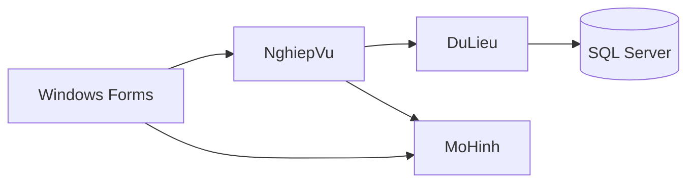
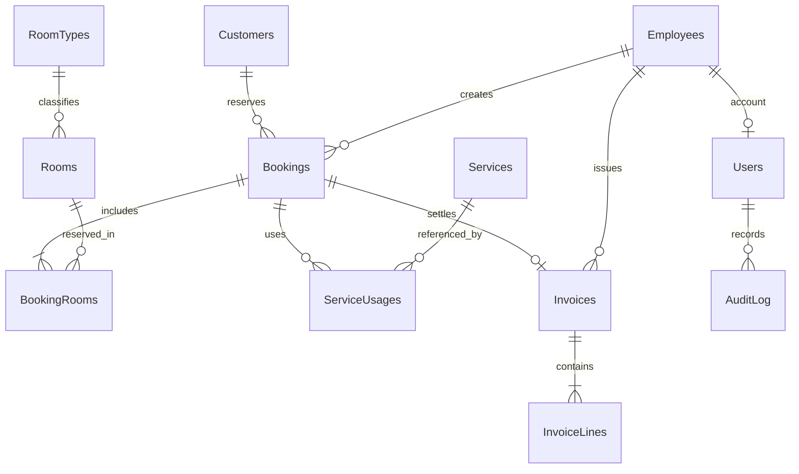
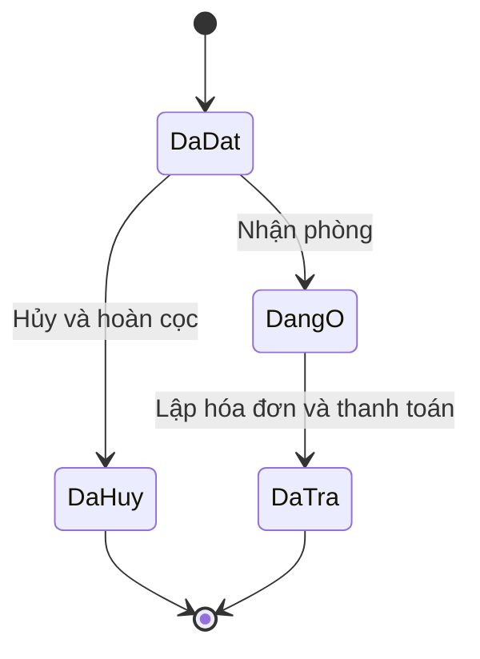

# Thiết kế hệ thống quản lý khách sạn

## Các tầng

`GiaoDien` nhận dữ liệu và hiển thị thông báo; `NghiepVu` là nơi kiểm tra quyền, trạng thái và quy tắc; `DuLieu` thực thi SQL tham số. `MoHinh` giữ các record dùng chung và phép tính tiền. Giao diện được xây dựng bằng C# để dễ theo dõi; chỉnh bố cục trong các constructor, không có file Designer kéo thả.

## Quan hệ dữ liệu

Phiếu đặt và lượt lưu trú dùng chung bảng `Bookings`, phân biệt bằng trạng thái. Cách này tránh sao chép thông tin từ phiếu đặt sang bảng thuê; có cả thời gian dự kiến và thực tế. `BookingRooms` giải quyết quan hệ nhiều-nhiều giữa phòng và phiếu, lưu giá/sức chứa chốt tại thời điểm đặt.

## Trạng thái

Phòng lưu tình trạng vận hành: Sẵn sàng, Chờ dọn, Bảo trì. Trạng thái Đang ở được suy ra từ `Bookings`, không lưu lặp trong `Rooms`. Sau trả phòng, phòng chuyển Chờ dọn; lễ tân xác nhận đã dọn để nhận khách mới.

## Kiểm tra trùng lịch

Hai khoảng thời gian giao nhau nếu `existing.Start < requested.Departure` và `existing.Departure > requested.Arrival`: với phiếu đang ở, `Start` là giờ nhận thực tế (`ActualCheckIn`); với phiếu đã đặt, dùng giờ đến dự kiến (`Arrival`). Bỏ qua phiếu đã hủy/đã trả, và bỏ qua chính phiếu đang sửa. Một lượt đang ở nhưng đã quá giờ đi dự kiến chặn yêu cầu bắt đầu ở hiện tại/quá khứ (`@from <= SYSDATETIME()`), không chặn mọi lịch tương lai. Khi nhận phòng hoặc đổi phòng, luôn kiểm tra thêm khách thực tế còn ở và phòng đã được dọn. Khoảng đến/đi cùng ngày hợp lệ khi giờ đi sau giờ đến; cách tính tiền vẫn tối thiểu một đêm.

Mọi thao tác ghi sử dụng giao dịch `Serializable` và `sp_getapplock` tài nguyên `HotelBTL.Write`. Kiểm tra phòng và lưu phiếu nằm trong cùng giao dịch. Khóa chung phù hợp quy mô bài tập một khách sạn; có thể tối ưu khóa theo từng phòng khi mở rộng.

## Lưu giá lịch sử và hóa đơn

- `BookingRooms.NightlyRate`: giá phòng lúc đặt, giữ nguyên khi sửa cùng phòng hoặc đổi phòng trong lượt ở. Đổi phòng cập nhật phòng hiện tại và sức chứa, chuyển phòng cũ sang Chờ dọn, ghi nhật ký cũ/mới; không tự định giá lại các đêm đã ở.
- `ServiceUsages`: tên, đơn vị, đơn giá lúc ghi nhận dịch vụ.
- `Invoices`: ảnh chụp thông tin khách, nhân viên, thời gian và tổng tiền lúc thanh toán.
- `InvoiceLines`: từng dòng phòng/dịch vụ và đơn giá chốt. Dịch vụ được gộp theo `ServiceId`, tên, đơn vị và đơn giá lịch sử trước khi lưu hóa đơn mới. Giữ các mức giá khác nhau và giữ nguyên hóa đơn đã phát hành. Trigger từ chối UPDATE/DELETE hóa đơn và chi tiết đã phát hành.

`Checkout` đọc lại dữ liệu dưới khóa và so với bản xem trước, tránh xác nhận số tiền cũ sau khi dịch vụ thay đổi. Trong cùng giao dịch: chèn hóa đơn, chèn chi tiết, chuyển phiếu Đã trả, chuyển phòng Chờ dọn, ghi nhật ký. Nếu bất kỳ câu lệnh nào lỗi thì tất cả cùng rollback.

`WalkIn` dùng chung các hàm lưu phiếu và nhận phòng trên cùng kết nối/giao dịch; tạo khách mới tùy chọn cũng thuộc giao dịch đó. `ChangeRoom` kiểm tra phiếu đang ở, quyền, phòng nguồn, trạng thái phòng đích, tổng sức chứa và lịch còn lại dưới cùng khóa ghi; phiếu quá giờ trả cần gia hạn trước. Cả hai không cần thay đổi cấu trúc database.

## Bảo vệ dữ liệu và quyền

Mật khẩu dùng PBKDF2 SHA-256, salt ngẫu nhiên 16 byte, 210.000 vòng, khóa 32 byte; so sánh thời gian cố định. Các giá trị nhập được truyền qua tham số SQL. Business kiểm tra lại tài khoản và trạng thái nhân viên ở mỗi thao tác, không chỉ ẩn nút trên giao diện. Mô hình phân quyền là phân quyền ứng dụng; người có quyền quản trị trực tiếp SQL Server vẫn có thể quản trị database.

## Kiểm thử

Bộ kiểm thử hiện có 56 trường hợp, bao gồm xác thực, phân quyền, dữ liệu trùng, SQL tham số, lịch phòng, sức chứa, đặt đồng thời, nhiều phòng, nhận phòng, hủy/hoàn cọc, giữ giá cũ, bảo trì, gia hạn, dịch vụ, tính tiền, cọc dư, giảm giá, bản xem trước hết hiệu lực, khóa hóa đơn, rollback và doanh thu. Các ca khởi tạo tái hiện lỗi SQL 5170 do trùng đường dẫn MDF, xác nhận ứng dụng và script cài đặt giữ nguyên dữ liệu cũ, và kiểm tra ba lần khởi tạo đồng thời. `KiemThuCaiTienLuuTru.cs` bổ sung 24 trường hợp về khách quá giờ trả, giờ nhận thực tế, khoảng giờ cùng ngày, đổi phòng, nhận khách nhanh, gộp dịch vụ và các giao dịch đồng thời/rollback. Mỗi lần chạy tạo database kiểm thử riêng và giữ lại để có thể kiểm tra dữ liệu; không dùng database bài tập chính.

`TaoCoSoDuLieu.sql` được dùng chung bởi DAL và script cài đặt: khóa theo tên database trong master, kiểm tra tồn tại, rồi tạo tệp MDF/LDF với hậu tố GUID trong thư mục mặc định của SQL Server. Schema và dữ liệu mẫu cũng có khóa riêng. Không tự xóa hay gắn lại tệp cũ không thuộc database hiện tại.

## Giới hạn và mở rộng

Hiện mỗi phiếu có một khách đại diện; chưa quản lý danh sách từng người ở ghép. Phiếu nhiều phòng nhận/trả đồng thời. Đã hỗ trợ đổi phòng trong lượt ở và đặt khoảng giờ cùng ngày; chưa hỗ trợ trả riêng từng phòng, chia hóa đơn, công nợ, đơn giá riêng theo mùa/giờ, tự động tính thuế, thanh toán trực tuyến hoặc tích hợp hóa đơn điện tử. Khi đổi phòng, hóa đơn thể hiện phòng hiện tại với giá đã chốt; lịch sử chuyển phòng nằm trong nhật ký, chưa tách tiền theo từng chặng phòng.
